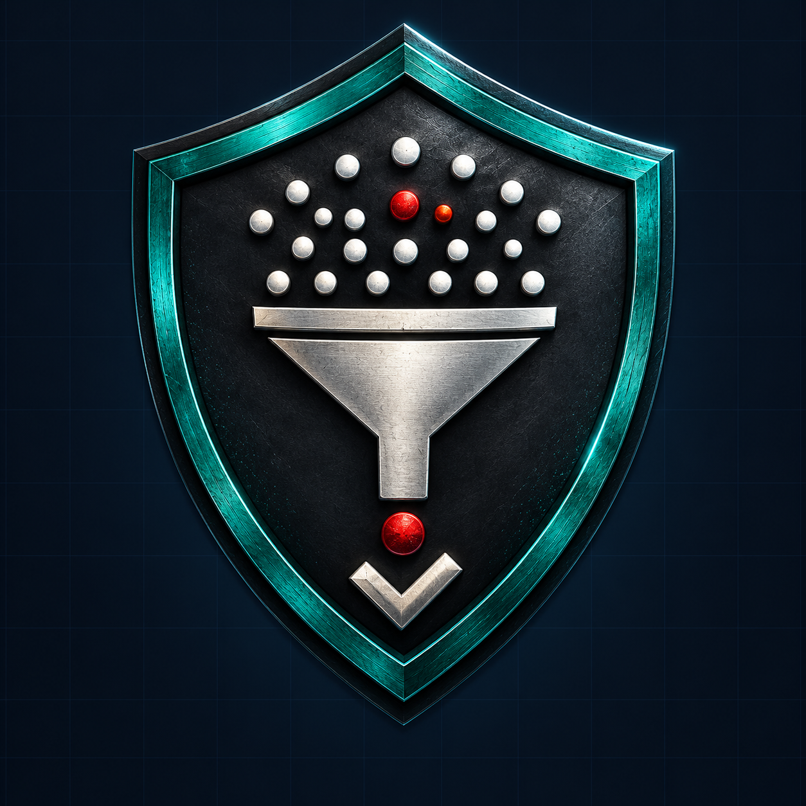
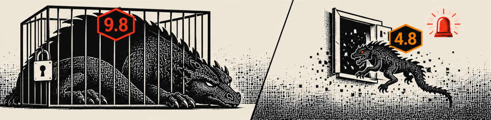
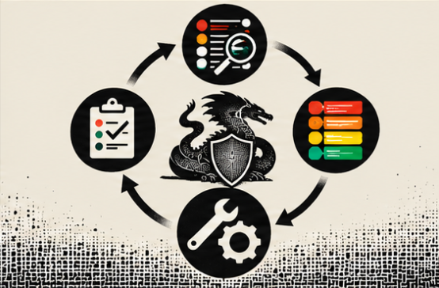

<a id="top"></a>

<p align="center"></p>

<h1 align="center">vuln-fix-first</h1>

<p align="center"><strong>Turn hundreds of security alerts into the few you fix today, with a deadline and the reason for each one.</strong><br>
An agent skill for Claude Code, Codex, GitHub Copilot CLI, Amp, OpenCode and any AI agent that reads <code>SKILL.md</code> files. Also runs on its own, no AI needed.</p>

<p align="center">
  <a href="https://github.com/kelsonbrito50/vuln-fix-first/releases"></a>
  <a href="https://github.com/kelsonbrito50/vuln-fix-first/actions/workflows/test.yml"></a>
  
  
  
  
</p>

<p align="center"></p>

**How it works, in 3 steps:**

1. **Scan** your project with the tool you already use: `npm audit --json > audit.json`, `pip-audit -f json`, Trivy, Grype or Dependabot.
2. **Ask** your agent: *"/vuln-fix-first this audit"* or *"which of these CVEs should I fix first?"*
3. **Get** each security bug labeled **ACT**, **ATTEND**, **TRACK\*** or **TRACK**, with a fix-by date and the packages to upgrade first.

## Choose where to start

| Your situation | Do this | What you get |
|---|---|---|
| **I have scanner output** (npm audit, pip-audit, Trivy, Grype) | Save it to a file, then ask your agent *"/vuln-fix-first audit.json"* | The bugs to fix today, with deadlines, and the upgrades that clear the most |
| **I have a list of CVE IDs** | `python scripts/vuln_fix_first.py CVE-2024-3400 CVE-2021-44228` | The same ranking, no AI needed |
| **I want it in CI or a script** | Add `--json` | Every field, machine-readable |
| **My team can only do a few upgrades** | Add `--capacity 3` | The 3 upgrades that matter most, and how much risk they remove |
| **I use the Claude app** | Upload the zip from [Releases](https://github.com/kelsonbrito50/vuln-fix-first/releases) | The skill inside Claude on the web or desktop |

**Try it without installing.** Paste this into any agent that can run commands (Claude Code, Codex, Copilot CLI...), in the folder with your scanner output:

```text
Clone https://github.com/kelsonbrito50/vuln-fix-first into a temporary folder, read its SKILL.md and follow it on audit.json.
```

---

## Why

A security scanner checks the libraries your project uses and lists their known security bugs. A typical project gets 50 to 200 of them. Many are labeled "high" or "critical", so you either fix none, or you lose a week on the wrong ones.

<p align="center"></p>

Most of those bugs are never used in a real attack. The urgent ones are those attackers are using **right now**, or those with public attack code that hit something important. `vuln-fix-first` checks exactly that for every bug, using free public data from the US government's cybersecurity agency (CISA) and from FIRST, a global group of security teams. It takes seconds.

**Real run:** `npm audit` on an old Express web app found 11 advisories, which mapped to 50 CVEs. Result: **0 ACT, 0 ATTEND, 4 TRACK\*** (all in `axios`, which has public attack code), and 46 that can wait for normal updates. Upgrading `axios` alone clears 23 of the 50. That took 5 seconds.

## Words you'll see

| Term | In plain words |
|---|---|
| **CVE** | The ID of one known security bug, like `CVE-2021-44228` (the famous Log4j bug). |
| **GHSA** | GitHub's ID for a security bug in a code package. `npm audit` uses these. The tool converts them to CVEs. |
| **KEV** | CISA's list of bugs that attackers are using in real attacks right now. If a bug is on it, fix it first. |
| **EPSS** | FIRST's estimate of the chance a bug gets attacked in the next 30 days, from 0% to 100%. |
| **CVSS** | A 0–10 score for how bad an attack *would* be. It doesn't say whether anyone is attacking. |
| **SSVC** | CISA's decision rules. They turn the facts above into a clear action (ACT, ATTEND, TRACK\*, TRACK). |
| **PoC** | "Proof of concept": public code that shows how to attack the bug. Attackers can copy it. |
| **Exposed** | Anyone on the internet can reach the system, like a public website or API. |

## Example

```
$ python scripts/vuln_fix_first.py CVE-2024-3400 CVE-2021-44228 CVE-2023-4863 CVE-2022-24999 CVE-2024-21626 --mission high --exposed
ACT     CVE-2024-3400    PAN-OS                   on KEV (actively exploited, used by ransomware); fix within 3 days + check for compromise (by 2026-10-22); EPSS 100.0% (top 0.1%); CVSS 3.1 10; automatable: yes, impact: total
ACT     CVE-2021-44228   Apache Log4j2            on KEV (actively exploited, used by ransomware); fix within 3 days + check for compromise (by 2026-10-22); EPSS 100.0% (top 0.1%); CVSS 3.1 10; automatable: yes, impact: total
ACT     CVE-2023-4863    Chrome                   on KEV (actively exploited); fix within 3 days + check for compromise (by 2026-10-22); EPSS 100.0% (top 0.1%); CVSS 3.1 8.8; automatable: no, impact: total
ATTEND  CVE-2024-21626   runc                     exploitation: public poc; fix within 14 days (by 2026-11-02); EPSS 18.9% (top 2.7%); CVSS 3.1 8.6; automatable: no, impact: total
ATTEND  CVE-2022-24999                            exploitation: public poc; fix within 14 days (by 2026-11-02); EPSS 15.6% (top 3.2%); CVSS 3.1 7.5; automatable: yes, impact: partial

ACT: 3  ATTEND: 2  TRACK*: 0  TRACK: 0  (mission: high, exposed: yes)

By package (one upgrade fixes all its CVEs):
  ACT     PAN-OS                            1 CVE, fix within 3 days + check for compromise by 2026-10-22
  ACT     Apache Log4j2                     1 CVE, fix within 3 days + check for compromise by 2026-10-22
  ACT     Chrome                            1 CVE, fix within 3 days + check for compromise by 2026-10-22
  ATTEND  runc                              1 CVE, fix within 14 days by 2026-11-02
  ATTEND  (unknown product)                 1 CVE, fix within 14 days by 2026-11-02

Expected to see attacks in the next 30 days (sum of EPSS): 3.35 of these 5 CVEs; after fixing ACT + ATTEND: 0.00
```

| Label | What to do |
|---|---|
| **ACT** | Fix now. Attackers are likely already using it against systems like yours. |
| **ATTEND** | Fix sooner than your normal update schedule. |
| **TRACK\*** | Fix in your normal update schedule, but keep an eye on it. |
| **TRACK** | Fix in your normal update schedule. |

"Check for compromise" means the bug is already being attacked, so patching isn't enough: also look for signs the system was broken into before you patched.

## Install

**One command, any agent:** the [`skills` CLI](https://skills.sh) finds the `SKILL.md` file and installs it into the agents you pick.
```
npx skills add kelsonbrito50/vuln-fix-first
```

Or copy it by hand with `git clone`:

**Claude Code**
```
git clone https://github.com/kelsonbrito50/vuln-fix-first ~/.claude/skills/vuln-fix-first
```

**Codex, GitHub Copilot CLI, Amp, OpenCode** (they share one skills folder)
```
git clone https://github.com/kelsonbrito50/vuln-fix-first ~/.agents/skills/vuln-fix-first
```
In Codex, type `$vuln-fix-first` or run `/skills`. In Claude Code, type `/vuln-fix-first`. Both also use the skill on their own when you ask what to fix first.

**Claude app (web or desktop):** download `vuln-fix-first.zip` from [Releases](https://github.com/kelsonbrito50/vuln-fix-first/releases), then upload it in **Settings → Capabilities → Skills**. Code execution must be on, and the sandbox must be allowed to reach the 4 sites listed under [Data sources](#data-sources-and-attribution).

**No agent:** the script runs on its own. It needs Python 3.9 or newer and nothing else to install.
```
python scripts/vuln_fix_first.py -f audit.json --mission high --exposed
npm audit --json | python scripts/vuln_fix_first.py
python scripts/vuln_fix_first.py CVE-2024-3400 GHSA-jfh8-c2jp-5v3q --json
```

| Option | What it means |
|---|---|
| `-f FILE` | Read a scanner report from a file. Any format works. |
| `-m`, `--mission low\|medium\|high` | How much the system matters to you. `high` for production or sensitive data, `low` for a test box. Default: `medium`. |
| `-x`, `--exposed` | The internet can reach the system. Deadlines get shorter. |
| `-c`, `--capacity N` | How many package upgrades your team can do now. Shows only the N that matter most, and how many CVEs they clear. |
| `-i`, `--ignore FILE` | Bugs you decided to live with for now ("accepted risk"). One line each: `CVE-2022-24999 2027-01-31 internal only, behind VPN`. They are skipped until that date, then ranked again. Lines starting with `#` are comments. |
| `--json` | Print machine-readable JSON instead of a table. |

## How it decides

<p align="center"></p>

1. **Find the bug IDs.** It pulls every CVE and GHSA ID out of the input text, so any scanner format works. GHSA IDs are converted to CVEs through [OSV.dev](https://osv.dev/), Google's open database of package bugs.
2. **Is it being attacked right now?** If the CVE is on CISA's KEV list, the answer is yes (`exploitation: active`). It also checks whether CISA says ransomware gangs use it.
3. **CISA's rating of the bug.** The official CVE record (from CVE.org) often holds CISA's answers to three questions:
   - Is there public attack code? (`exploitation: none / public poc / active`)
   - Can an attacker automate it across many targets? (`automatable: yes / no`)
   - Does a successful attack give full control? (`impact: partial / total`)

   When CISA hasn't rated a bug, the tool assumes the worst for the last two and says so in the output.
4. **Your situation.** `--mission` (how important the system is) and `--exposed` (reachable from the internet).
5. **The label.** CISA's SSVC decision table (CISA Coordinator, v2.0.3) turns steps 2–4 into ACT, ATTEND, TRACK\* or TRACK.
6. **The deadline.** CISA's BOD 26-04 table turns "on KEV", "exposed", "automatable" and "impact" into a fix-by date: 3 days (plus a compromise check if it's already being attacked), 14 days, 60 days, or the next major system upgrade.
7. **The order.** Within each label: bugs on KEV first, then those used by ransomware, then higher EPSS.
8. **By package.** Bugs are grouped by the library or product they're in, so you see which single upgrade clears the most. With `--capacity N`, only the first N packages are shown.
9. **Expected attacks.** EPSS is a probability, so adding up the EPSS of all bugs gives the number of them expected to be attacked in the next 30 days. The tool shows that number before and after the fixes it suggests, so you can see how much risk the work removes.

Next to each EPSS value you'll see its percentile, for example `EPSS 18.9% (top 2.7%)`: the bug scores higher than 97.3% of all known CVEs.

A bug with a CVSS score of 9.8 can still be TRACK. CVSS says how bad an attack *would* be, not whether anyone is attacking.

## Privacy: what leaves your machine

Only bug IDs. Your scanner report, source code, package names, versions and file paths stay on your computer.

| Site | What the script sends |
|---|---|
| `www.cisa.gov` | Nothing. It downloads the whole KEV list. |
| `api.first.org` | The CVE IDs, up to 100 per request. |
| `cveawg.mitre.org` | One CVE ID per request. |
| `api.osv.dev` | One GHSA ID per request, only when the input has GHSA IDs. |

No API key, no account, no telemetry. The connections use HTTPS, and the script makes no other network calls.

## FAQ

**Why is a CVSS 9.8 bug only TRACK?**
CVSS measures how bad an attack *would* be. It doesn't say whether anyone attacks that bug. If a bug isn't on KEV, has no public attack code and the system isn't critical, CISA's rules say it can wait for your normal update schedule.

**Does it work offline?**
No. The ranking depends on today's KEV list and EPSS scores, which change every day. Without KEV the script stops, because it would hide bugs that are being attacked. Without EPSS it warns and goes on.

**Why is a bug marked "assumed"?**
CISA hasn't rated it yet. For "automatable" and "impact" the tool then assumes the worst case, so the bug may rank higher than it should. For "exploitation" it assumes `none` unless the bug is on KEV, because KEV already lists the bugs known to be attacked.

**Can I trust the deadline?**
The deadlines come from CISA's BOD 26-04 table, written for US federal agencies. They are a strong baseline, not a law for you. Your own policy can be stricter.

**Which scanners work?**
Any of them. The script pulls CVE and GHSA IDs out of any text, so the format doesn't matter.

## Evidence and limits

- **Tested** with 20 unit tests (Python 3.9 and 3.13 in CI), and live runs on `npm audit` and `pip-audit` output, a CVE list, UTF-16 files from Windows PowerShell, and `--json`.
- A CVE ID that doesn't exist is still listed, as TRACK with every value "assumed", plus a warning.
- Some CVE records have no product or package name, so the product column can be blank or "(unknown product)".
- The label and the deadline come from two different CISA tables, so they can disagree, for example TRACK with a 60-day deadline. Both are shown on purpose.
- GHSA IDs with no matching CVE are skipped.

## Tests
```
python tests/test_vuln_fix_first.py
```

## Data sources and attribution
The script downloads live data from these 4 sites each time it runs:

| Source | Site | Used for |
|---|---|---|
| [CISA KEV catalog](https://www.cisa.gov/known-exploited-vulnerabilities-catalog) | `www.cisa.gov` | Bugs attacked right now, and ransomware use |
| [FIRST EPSS](https://www.first.org/epss/) | `api.first.org` | Chance of attack in the next 30 days |
| [CVE.org](https://www.cve.org/) records, with CISA's added ratings ("Vulnrichment") | `cveawg.mitre.org` | CVSS score, product name, CISA's SSVC answers |
| [OSV.dev](https://osv.dev/) | `api.osv.dev` | Converting GHSA IDs to CVEs |

The label and deadline tables come from the [SSVC project](https://github.com/CERTCC/SSVC) by CERT/CC: CISA Coordinator v2.0.3 and CISA BOD 26-04 v1.0.0.

## License
[MIT](LICENSE) © Kelson Brito

The embedded SSVC decision tables are © Carnegie Mellon University under an MIT-style license, and the data sources have their own terms: see [THIRD_PARTY_NOTICES.md](THIRD_PARTY_NOTICES.md). This project is not affiliated with or endorsed by CISA, FIRST, MITRE, Carnegie Mellon University, Google, Anthropic or OpenAI.

<p align="center">
  <strong>FIX WHAT'S ATTACKED, NOT WHAT'S LOUD.</strong>
  <br>
  <a href="#top">Back to top ↑</a>
</p>
